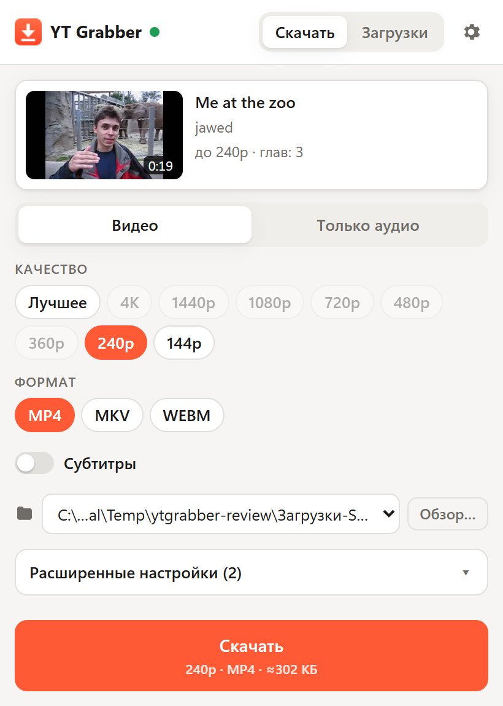
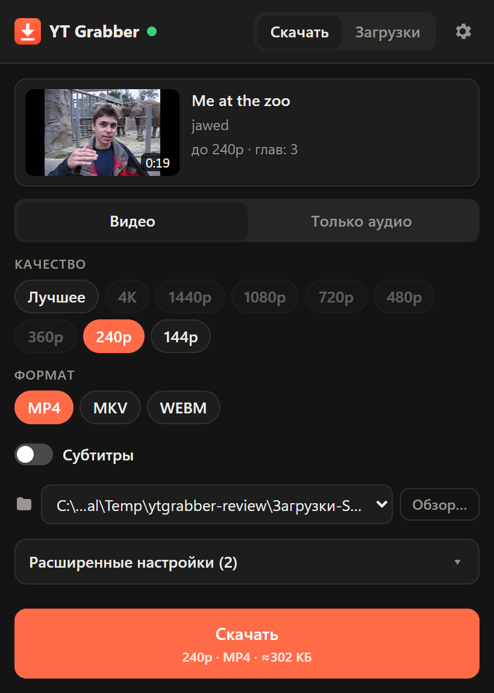
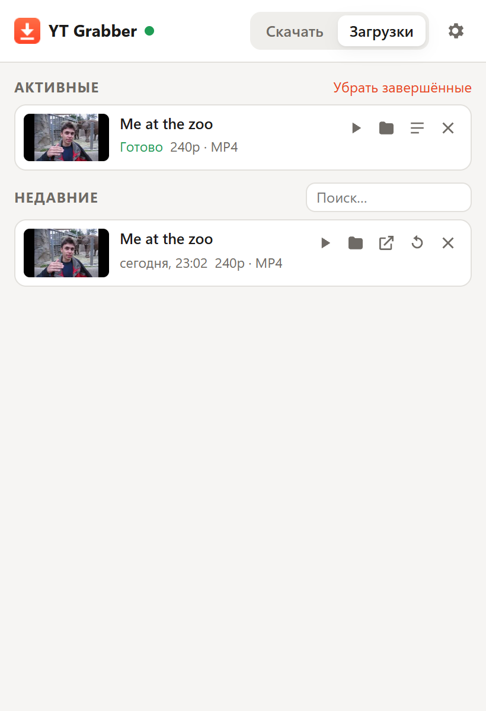

<p align="center"></p>

<h1 align="center">YT Grabber</h1>

<p align="center">
  A Chrome extension for downloading YouTube video, audio and subtitles — powered by
  <a href="https://github.com/yt-dlp/yt-dlp">yt-dlp</a> and FFmpeg, with a one-click button right on YouTube.<br>
  <b>English</b> · <a href="#-русский">Русский</a>
</p>

<p align="center">
  <a href="https://github.com/MBudkin/YT-Grabber/releases/latest"></a>
  
  
  
</p>

<p align="center">
  
  
  
</p>

## Features

- **Quick presets** — best quality, 4K…144p, MP4/MKV/WEBM, or audio only (MP3, M4A, OPUS, FLAC, WAV).
  Qualities the video doesn't have are greyed out; the button shows the final format and estimated size.
- **Subtitles** — pick languages (`*` marks auto-generated), embed into the file or save as SRT/VTT/ASS.
- **Download button on YouTube** next to Like/Share (and in Shorts) with live progress; the arrow offers
  “with subtitles” and “audio only”. Also: right-click menu on any YouTube link and the `Alt+Shift+D` hotkey.
- **Advanced options** — exact format, H.264+AAC compatibility mode, 60 fps, video section (start–end,
  or take the current player position), **SponsorBlock** cutting, thumbnail/metadata/chapters, split by chapters,
  filename template, playlist items, speed limit, browser cookies for private/age-restricted videos.
- **Playlists**, parallel downloads with a queue, history of the last 30 downloads, Windows notifications.
- **Interface in English and Russian** — detected automatically from the browser, or chosen in Settings.
- **Automatic updates** — the extension checks GitHub releases and updates itself and the helper in one click
  (or silently, if enabled); yt-dlp is updated daily.

## Installation (Windows 10/11 x64)

1. Download **`YT-Grabber.zip`** from the [latest release](https://github.com/MBudkin/YT-Grabber/releases/latest),
   extract it completely and run **`Install.bat`**. yt-dlp, FFmpeg and QuickJS are bundled; no admin rights needed.
2. Open `chrome://extensions`, turn on **Developer mode**.
3. Click **Load unpacked** and paste the path the installer copied to the clipboard:
   `%LOCALAPPDATA%\YT Grabber\extension`
4. Open any YouTube video and click the YT Grabber icon (or the **Download** button under the video).

Videos are saved to `Downloads\YT Grabber` by default. Works in Chrome, Edge, Brave, Vivaldi, Yandex Browser
and other Chromium browsers. To uninstall, run `Uninstall.bat` and remove the extension — downloaded files stay.

### Updates

Settings → **Updates**: YT Grabber checks for a new release every 6 hours and shows a banner in the popup.
Clicking **Update** downloads the release, verifies its SHA-256, reinstalls the helper and reloads the extension.
With “Install updates automatically” on, this happens by itself while nothing is downloading.

## How it works

```
Chrome extension (MV3) ⇄ Native Messaging ⇄ helper (ytdl_host.exe) ⇄ yt-dlp.exe + FFmpeg
```

A browser extension can't start programs, so a small helper is registered for the current user
(HKCU, Chrome's official Native Messaging). It runs yt-dlp with a fixed, validated set of arguments
and reports progress back. Protocol and internals: [SPEC.md](SPEC.md).

## Troubleshooting

| Symptom | Fix |
|---|---|
| “Helper is not installed” | Run `Install.bat`, then fully restart the browser |
| HTTP 403 / “Sign in to confirm” | Settings → **Update yt-dlp**; for private videos use browser cookies (Advanced) |
| No sound / no 1080p+ | Check the FFmpeg path in Settings |
| Details of an error | **Log** button on a download, `%LOCALAPPDATA%\YT Grabber\host.log` |

## Building from source

```powershell
powershell -ExecutionPolicy Bypass -File build\build.ps1   # → dist\YT-Grabber.zip
```

Requires 64-bit Python 3 (PyInstaller is installed into a temporary venv). The script downloads yt-dlp,
FFmpeg and QuickJS and verifies their checksums. Integration test of an installed helper: `py -3 host\test_host.py`.

To publish an update, bump `version` in `extension/manifest.json` **and** `VERSION` in `host/ytdl_host.py`,
build, and attach `dist/YT-Grabber.zip` to a GitHub release tagged `vX.Y.Z`.

> Please download only videos you have the right to download (your own, openly licensed, etc.)
> and respect YouTube's Terms of Service and copyright law.

---

## 🇷🇺 Русский

**YT Grabber** — расширение Chrome для скачивания видео, аудио и субтитров с YouTube через yt-dlp и FFmpeg.

### Возможности

- Быстрые пресеты: лучшее качество, 4K…144p, MP4/MKV/WEBM или только аудио (MP3, M4A, OPUS, FLAC, WAV);
  на кнопке видно итоговые параметры и примерный размер.
- Субтитры с выбором языков (`*` — автоматические), встраивание или отдельный файл SRT/VTT/ASS.
- **Кнопка «Скачать» прямо на YouTube** рядом с лайками (и в Shorts) с прогрессом; стрелка — «с субтитрами»
  и «только аудио». Плюс контекстное меню на ссылках и горячая клавиша `Alt+Shift+D`.
- Расширенные настройки: точный формат, совместимость H.264+AAC, 60 fps, фрагмент видео, **SponsorBlock**,
  обложка/метаданные/главы, шаблон имени, элементы плейлиста, лимит скорости, cookies браузера.
- Плейлисты, очередь параллельных загрузок, история, уведомления Windows.
- **Интерфейс на русском и английском** — определяется автоматически по языку браузера или выбирается в настройках.
- **Автообновление** — расширение само проверяет релизы на GitHub и обновляется в один клик (или автоматически);
  yt-dlp обновляется ежедневно.

### Установка (Windows 10/11 x64)

1. Скачайте **`YT-Grabber.zip`** из [последнего релиза](https://github.com/MBudkin/YT-Grabber/releases/latest),
   полностью распакуйте и запустите **`Install.bat`** (права администратора не нужны).
2. Откройте `chrome://extensions` и включите **«Режим разработчика»**.
3. Нажмите **«Загрузить распакованное расширение»** и вставьте путь, скопированный установщиком:
   `%LOCALAPPDATA%\YT Grabber\extension`
4. Откройте видео на YouTube и нажмите значок YT Grabber или кнопку **«Скачать»** под видео.

По умолчанию файлы сохраняются в `Загрузки\YT Grabber`. Удаление — `Uninstall.bat` и удаление расширения;
скачанные файлы сохранятся.

### Если что-то не работает

| Симптом | Решение |
|---|---|
| «Помощник не установлен» | запустить `Install.bat`, полностью перезапустить браузер |
| Ошибка 403 / «Sign in to confirm» | Настройки → «Обновить yt-dlp»; для приватных видео — cookies браузера |
| Нет звука / нет 1080p+ | проверьте путь к FFmpeg в настройках |
| Подробности ошибки | кнопка «Журнал» у загрузки, файл `%LOCALAPPDATA%\YT Grabber\host.log` |

Используйте только для видео, на скачивание которых у вас есть право.

## License

[MIT](LICENSE) for the YT Grabber code. The release archive bundles third-party tools under their own licenses: yt-dlp (Unlicense), FFmpeg (GPL, see `bin/ffmpeg/LICENSE.txt`), QuickJS-NG (MIT).
